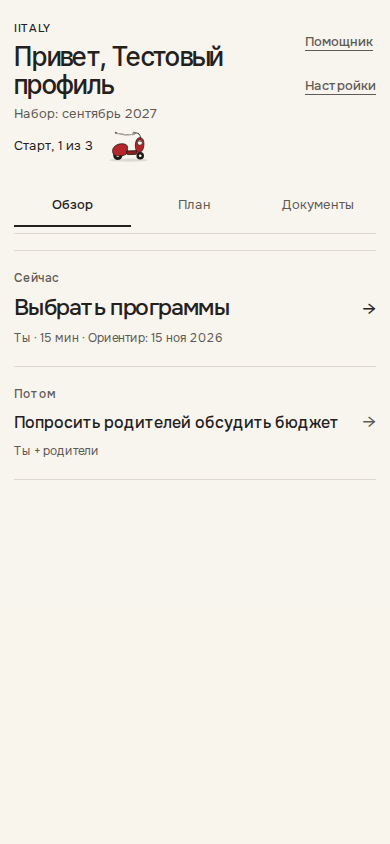
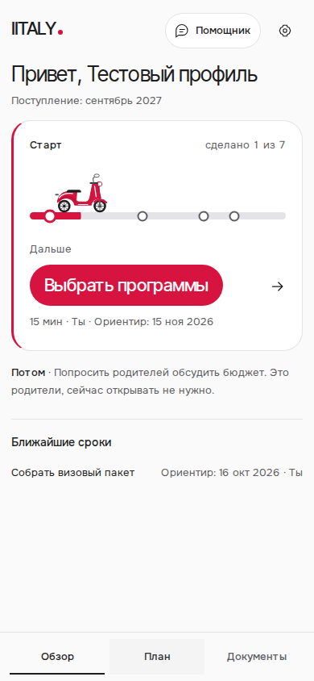

# IITALY portal — release review, 14 October 2026

Before: main after PR #79 (`a470a0235757ce11e9eea955b44c29ce84dde623`). After: the three-part portal update in PRs #80, #81 and #82. All screens use synthetic profiles from `scripts/design-portal-progress-review.mjs`; no real account, document, payment or Telegram message was used.

## Six screens at both requested widths

| Screen | Before 390 | After 390 | Before 1440 | After 1440 |
| --- | --- | --- | --- | --- |
| Overview | [before 390](before/overview-partial-390.png) | [after 390](after/overview-partial-390.png) | [before 1440](before/overview-partial-1440.png) | [after 1440](after/overview-partial-1440.png) |
| Plan | [before 390](before/plan-partial-390.png) | [after 390](after/plan-partial-390.png) | [before 1440](before/plan-partial-1440.png) | [after 1440](after/plan-partial-1440.png) |
| Current step | [before 390](before/step-partial-390.png) | [after 390](after/step-partial-390.png) | [before 1440](before/step-partial-1440.png) | [after 1440](after/step-partial-1440.png) |
| Documents | [before 390](before/documents-partial-390.png) | [after 390](after/documents-partial-390.png) | [before 1440](before/documents-partial-1440.png) | [after 1440](after/documents-partial-1440.png) |
| Settings | [before 390](before/settings-partial-390.png) | [after 390](after/settings-partial-390.png) | [before 1440](before/settings-partial-1440.png) | [after 1440](after/settings-partial-1440.png) |
| Onboarding | [before 390](before/onboarding-onboarding-390.png) | [after 390](after/onboarding-onboarding-390.png) | [before 1440](before/onboarding-onboarding-1440.png) | [after 1440](after/onboarding-onboarding-1440.png) |

## Route states

| State | Before 390 | After 390 | Before 1440 | After 1440 |
| --- | --- | --- | --- | --- |
| near | [before 390](before/overview-near-390.png) | [after 390](after/overview-near-390.png) | [before 1440](before/overview-near-1440.png) | [after 1440](after/overview-near-1440.png) |
| parent-file | [before 390](before/overview-parent-file-390.png) | [after 390](after/overview-parent-file-390.png) | [before 1440](before/overview-parent-file-1440.png) | [after 1440](after/overview-parent-file-1440.png) |
| late-current | [before 390](before/overview-late-current-390.png) | [after 390](after/overview-late-current-390.png) | [before 1440](before/overview-late-current-1440.png) | [after 1440](after/overview-late-current-1440.png) |

## Decisions and unchanged contracts

- Marketing palette and sans-serif type now continue through onboarding and the portal. The existing sidebar remains; the faint sidebar illustration is removed.
- The whole scooter road is one anchor to the current step. The red pill is part of that anchor, not a nested control. Counts and stage positions use the actual user roadmap. A server-confirmed completion changes the next-step text immediately, returns to overview and drives the scooter once. Initial load/reload and reduced motion never drive.
- The helper remains one header entry with the open step ID. A second floating helper and duplicate helper card were deliberately not added, preserving the agreed single-entry navigation. Mobile has exactly three persistent primary links; settings has its own active icon and a return link.
- Documents are visible without opening five empty accordions. Native counted filters hide empty statuses, keep the five exact outcome labels, and preserve one row/one link. Reports retain their saved reason, next action and source disclosure. Future files remain read-only.
- At most two nearby dates from other stages are shown as plain text. These are existing API dates labelled «Ориентир»; they do not become deadlines, unlock a task or change its order.
- Telegram connect is the single settings action button, inside its initially collapsed reminder row. Deletion retains the existing confirmation and is visually separated with an outlined trash action, without using document-error red.
- Initial onboarding says «Построить маршрут». Editing an existing profile still says «Сохранить». The three-question hint is hidden when the additional 11-year education question is required.
- No backend/API, auth, Stripe, prices, document-verdict schema or MOD. 209 geometry changes.
- The existing API has no program-shortlist storage field. This release preserves the university catalogue link and explicit self-report; it does not present a fake saved program form. A file step closes only when the unchanged backend confirms it; clarification/error/unreadable results remain open in their full report.

## Verification

- Production static export and ESLint.
- Portal progress/navigation: 1440, 1024, 768, 390×844, 390×667 and 320 px; real 28-step/seven-stage fixture; future/parent steps, history/reload, profile editing, manual undo, helper context, actual CSS interpolation and reduced motion.
- Document reports at 1440, 390 and 320 px: five exact statuses, reload without a new AI charge, full saved findings and sources, no nested row actions, axe checks.
- Reminder connection/confirmation/disconnection/retry at six widths; launch payment and document-save recovery.
- GitHub Design review additionally gates login, general UX/axe, admissions, public routes, university comparison and exact MOD. 209 behavior. No assertion was removed to bypass a failure.
- Updated test invariants: whole-road navigation replaces a percentage bar; visible documents plus counted filters replace status accordions; settings allows its one Telegram mutation button. Source facts and API assertions stay in place.

## Reproduce the after captures

```sh
NEXT_PUBLIC_BACKEND_URL=https://example.invalid NEXT_PUBLIC_STRIPE_ENABLED=true npm run build
REVIEW_TOOLS=/tmp/iitaly-browser/node_modules PORTAL_RELEASE_CAPTURE=1 node scripts/design-portal-progress-review.mjs
```

Capture mode reuses the exact progress-test fixtures and writes the six surfaces plus `near`, `parent-file`, `late-current` at both widths to `design-review/after`. Default test execution still runs the full functional gate. The fixed mobile navigation appears at the initial viewport edge in full-page PNGs; it remains fixed to the screen while scrolling.

## Mobile overview




