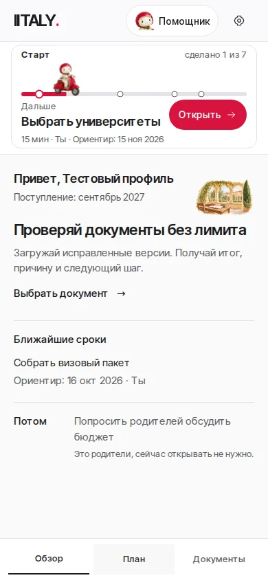
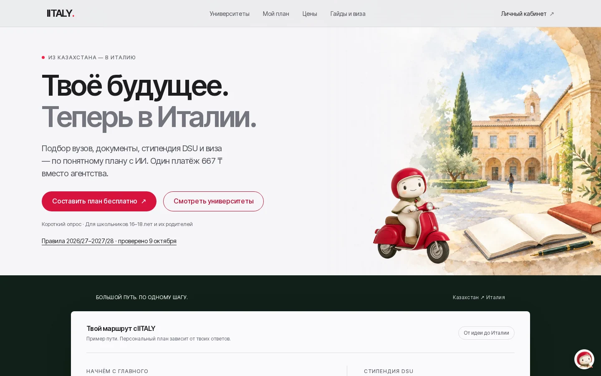

# Веспи Баурысаков: интеграция утверждённого персонажа

Вместо разных рисованных скутеров сайт использует выбранного пользователем
персонажа Crema Soft. На маленьких элементах видно лицо, на маршруте и
иллюстрациях — всего героя. Имя в помощнике: **Веспи Баурысаков**.

## Что изменилось

- Дорога в кабинете: Веспи едет вместе с заполнением после подтверждённого
  завершения шага. Текст следующего шага меняется сразу. Первый показ статичный.
- Помощник: лицо в шапке кабинета, плавающем входе на остальных страницах и
  заголовке чата; единое имя и прежний контекст открытого шага.
- Главная и вход: персонаж в свободной части существующей акварели кампуса.
- Онбординг: небольшой портрет рядом с заголовком, без отдельной секции.
- Проверка документов, подтверждения и 404: тот же персонаж через совместимый
  компонент, без добавления кнопок и экранов.

Полный образ не повторяется в списках и юридически значимых сообщениях.
Обзор, План, Документы, настройки, маршруты, Stripe, авторизация, API,
пять статусов и геометрия MOD. 209 сохранены.

## Ассеты и движение

Пять локальных прозрачных WebP: всего **98 996 байт**. Основной маленький
ассет дороги — **9 532 байта**, аватар — **3 970 байт**. CDN генератора
в приложении не используется. Исходник и точные кропы указаны в `assets.json`.

Изображение не анимируется внутри: проезд, лёгкое покачивание и прибытие
происходят на обёртках через transform/opacity. `prefers-reduced-motion`
выключает движение. Загрузка не вызывает изменения размеров блока.

Сознательно изменён только визуальный инвариант в
`design-portal-progress-review`: вместо вращения колёс старого SVG проверяется
загрузка утверждённого WebP и неподвижность его пикселей. Проверки реального
движения, синхронности заполнения и персонажа, 1080ms easing, немедленного
нового шага, серверного подтверждения, ошибок и reduced motion сохранены.
Ограничение высоты закреплённого блока (210px) не ослаблено.

## Скриншоты

Тестовые данные из существующей фикстуры, без реальных пользователей.
Для каждого экрана сохранены версии до/после на 1440 и 390px в `screens/`.
Состояния маршрута: partial, near, parent-file, late-current.

## Воспроизведение

```sh
NEXT_PUBLIC_BACKEND_URL=https://example.invalid NEXT_PUBLIC_STRIPE_ENABLED=true npm run build
REVIEW_TOOLS=/tmp/iitaly-browser/node_modules node scripts/design-portal-progress-review.mjs
REVIEW_TOOLS=/tmp/iitaly-browser/node_modules PORTAL_RELEASE_CAPTURE=1 node scripts/design-portal-progress-review.mjs
REVIEW_TOOLS=/tmp/iitaly-browser/node_modules node scripts/design-portal-login-review.mjs
REVIEW_TOOLS=/tmp/iitaly-browser/node_modules node scripts/design-portal-document-report-review.mjs
REVIEW_TOOLS=/tmp/iitaly-browser/node_modules node scripts/design-reminders-review.mjs
REVIEW_TOOLS=/tmp/iitaly-browser/node_modules node scripts/design-ux-review.mjs
REVIEW_TOOLS=/tmp/iitaly-browser/node_modules node scripts/launch-chat-review.mjs
```

Для отдельной папки браузера задаётся `PLAYWRIGHT_BROWSERS_PATH`.
Проверки используют изолированные ответы API; реальные файлы и аккаунты не затрагиваются.

## До и после

| Экран | 1440px | 390px |
| --- | --- | --- |
| Главная | [до](screens/before-home-1440.webp) · [после](screens/after-home-1440.webp) | [до](screens/before-home-390.webp) · [после](screens/after-home-390.webp) |
| Вход | [до](screens/before-login-1440.webp) · [после](screens/after-login-1440.webp) | [до](screens/before-login-390.webp) · [после](screens/after-login-390.webp) |
| Помощник | [до](screens/before-helper-1440.webp) · [после](screens/after-helper-1440.webp) | [до](screens/before-helper-390.webp) · [после](screens/after-helper-390.webp) |
| Обзор | [до](screens/before-overview-partial-1440.webp) · [после](screens/after-overview-partial-1440.webp) | [до](screens/before-overview-partial-390.webp) · [после](screens/after-overview-partial-390.webp) |
| План | [до](screens/before-plan-partial-1440.webp) · [после](screens/after-plan-partial-1440.webp) | [до](screens/before-plan-partial-390.webp) · [после](screens/after-plan-partial-390.webp) |
| Шаг | [до](screens/before-step-partial-1440.webp) · [после](screens/after-step-partial-1440.webp) | [до](screens/before-step-partial-390.webp) · [после](screens/after-step-partial-390.webp) |
| Документы | [до](screens/before-documents-partial-1440.webp) · [после](screens/after-documents-partial-1440.webp) | [до](screens/before-documents-partial-390.webp) · [после](screens/after-documents-partial-390.webp) |
| Настройки | [до](screens/before-settings-partial-1440.webp) · [после](screens/after-settings-partial-1440.webp) | [до](screens/before-settings-partial-390.webp) · [после](screens/after-settings-partial-390.webp) |
| Онбординг | [до](screens/before-onboarding-onboarding-1440.webp) · [после](screens/after-onboarding-onboarding-1440.webp) | [до](screens/before-onboarding-onboarding-390.webp) · [после](screens/after-onboarding-onboarding-390.webp) |
| Близкий ориентир | [до](screens/before-overview-near-1440.webp) · [после](screens/after-overview-near-1440.webp) | [до](screens/before-overview-near-390.webp) · [после](screens/after-overview-near-390.webp) |
| Файл родителей | [до](screens/before-overview-parent-file-1440.webp) · [после](screens/after-overview-parent-file-1440.webp) | [до](screens/before-overview-parent-file-390.webp) · [после](screens/after-overview-parent-file-390.webp) |
| Поздний текущий шаг | [до](screens/before-overview-late-current-1440.webp) · [после](screens/after-overview-late-current-1440.webp) | [до](screens/before-overview-late-current-390.webp) · [после](screens/after-overview-late-current-390.webp) |
| 404 | [до](screens/before-not-found-1440.webp) · [после](screens/after-not-found-1440.webp) | [до](screens/before-not-found-390.webp) · [после](screens/after-not-found-390.webp) |





## Результат локальных проверок

- Production static export, TypeScript, ESLint изменённых компонентов и design guard: пройдены.
- Полный progress review: **33 сценария**, без ошибок браузера и неожиданных API-запросов (см. `progress-results.json`).
- Login review: 1440, 1024, 768, 390 и 360px.
- Saved document report review: все пять исходов и повторная проверка.
- Reminders review: подключение, подтверждение, выключение и восстановление после ошибки.
- UX/axe: 1440, 768, 390 и 320px.
- Launch chat и document recovery: фокус, клавиатура, таймауты и повторные попытки.
