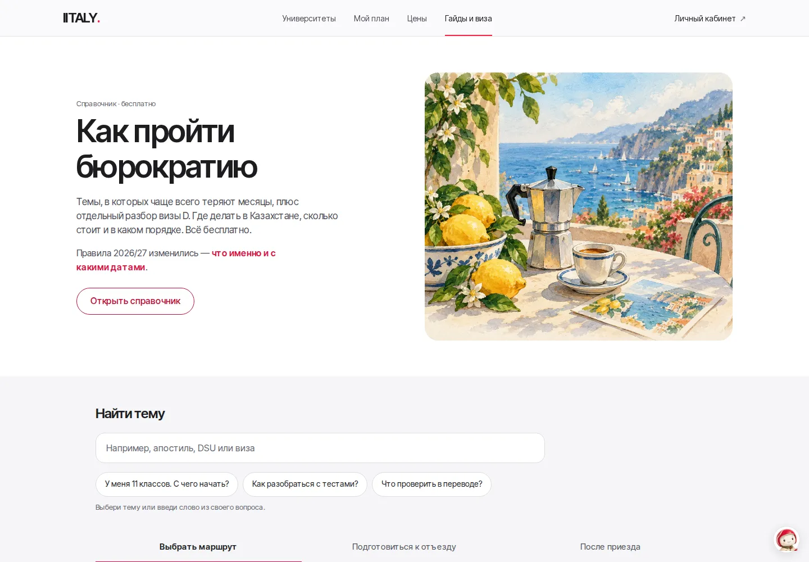
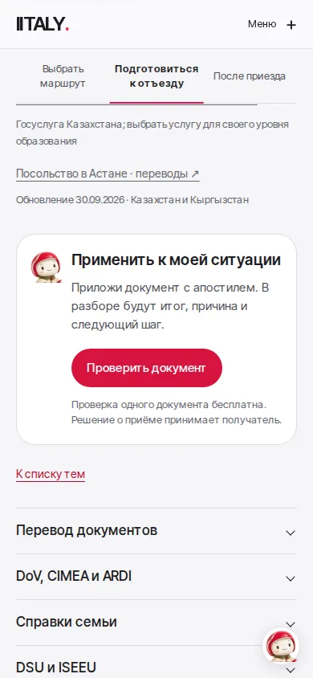

# Веспи: реже, узнаваемее, ближе к действию

Пользователь попросил взять за ориентир
[Meta AI Assistant](https://ai.meta.com/meta-ai/assistant/), использовать Веспи
«редко, но метко» и добавить небольшую деталь, сохранив образ.

## Решение

Страница Meta просмотрена в браузере 17 октября 2026: крупная типографика,
свободные поля, один акцент действия, примеры продукта и спокойные переключатели
по темам. Это визуальное наблюдение, не доказательство роста конверсии.
IITALY сохраняет свои цвета, шрифты, итальянские иллюстрации и тексты.

- `/guides`: иллюстрация террасы в отдельном спокойном поле, ясный поиск и
  вопросы-примеры. Подчёркивание отмечает открытую тему, не «прогресс чтения».
- Убраны повторные изображения Веспи из героя справочника, поиска,
  навигации, предупреждений и строки возвращения из гайда.
- Веспи остался у контекстного следующего действия и в существующем помощнике.
  Маршрут кабинета, главная, вход и функциональные состояния используют ту же
  обновлённую общую иллюстрацию. Новых секций, виджетов и действий нет.
- Предупреждения, источники, якоря, контекст помощника и переходы квиза прежние.
  Провайдерская плашка по-прежнему не перекрывает чат.

## Деталь персонажа

На прежний шлем добавлена кремовая дорожная полоса с оливковой точкой.
Плюшевое лицо, выражение, плащ, обувь и красный скутер сохранены по референсу.
Это локальная правка идентичности, а не генерация новой семьи персонажей.

Использован встроенный Imagegen, режим редактирования с прозрачным фоном.
Референс: `public/mascot/vespi/vespi-ride-640.webp`.
Мастер: `design/mascot/vespi/vespi-route-master.webp`.
Файлы для сайта: `public/mascot/vespi/vespi-*-route-*.webp`.

Ключевой текст запроса к генератору: «Preserve exactly this character's
recognizable ivory softly plush micro-velvet face, black oval eyes, peach
cheeks, gentle small smile, head/body proportions, glossy raspberry-red Italian
helmet, cream cape with olive trim and red clasp, suede boots, classic red
scooter, pose, three-quarter side camera and soft lighting. The sole design
change: add one narrow warm-ivory curved racing stripe on the visible side of
the helmet, offset from the centre. It subtly resembles a winding route and
ends in a tiny muted-olive circular way-point. No new props, scenery or text.»

Упаковка через Sharp: rider 160/320/640px, соотношение 320:397; аватар
из области `(244, 0, 560, 560)` исходного PNG 1126×1397, 96/192px.
WebP quality 74 для rider, 78 для аватара, alphaQuality 90. Все пять файлов
95 426 байт; самый маленький rider 9 068 байт. Новые имена обновляют кеш.

## Проверки

Проверка справочника сохраняет все проверки данных, переходов и доступности.
Изменены только визуальные инварианты: отсутствие повторных аватарок,
один персонаж у действия открытой темы и подчёркивание вместо аватара в ленте.
Проверка кабинета принимает новое версионированное имя ассета; логика
подтверждения задач и движения не менялась.
Тест клавиатуры теперь ждёт реального автофокуса в чате перед Escape:
сохранённое значение поля доступно раньше следующего animation frame.
Ранее на 320px тест успевал нажать Escape на внешней кнопке до фокуса в чате.

Пройдены локально: production static export, TypeScript, ESLint изменённых
компонентов, `design-ux-review` (axe, 320/390/768/1440px),
`design-guides-vespi-review` (4 ширины) и `design-portal-progress-review`
(33 сценария, ноль ошибок браузера и неожиданных API-запросов).
[Справочник](guides-results.json) · [Кабинет](portal-results.json).
Результаты и изображения финального прохода добавлены рядом с этим файлом.
Снимки «до» соответствуют main после PR #97.

| Экран | 1440px | 390px |
| --- | --- | --- |
| Начало справочника | [до](screens/before-top-1440.webp) · [после](screens/after-top-1440.webp) | [до](screens/before-top-390.webp) · [после](screens/after-top-390.webp) |
| Следующее действие | [до](screens/before-next-1440.webp) · [после](screens/after-next-1440.webp) | [до](screens/before-next-390.webp) · [после](screens/after-next-390.webp) |

